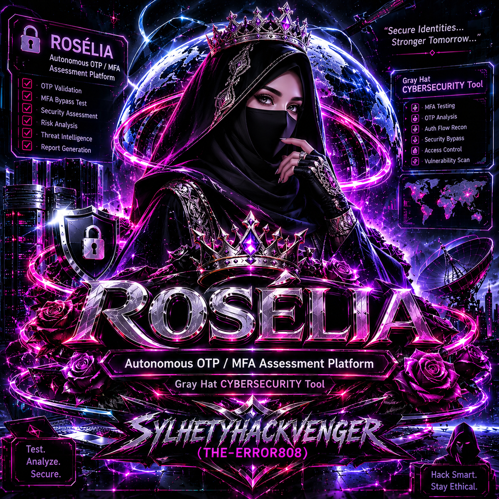

<p align="center">
  
</p>

# <div align="center">RoseLia — Autonomous OTP / MFA Assessment Platform</div>

<div align="center">

AUTHOR: SYLHETYHACKVENGER (THE-ERROR808)

VERSION: 1.0.0

LICENSE: For authorized security assessments only.

</div>

---

Overview

RoseLia is a next-generation, autonomous OTP/MFA security assessment platform engineered for professional penetration testers, red teams, and security researchers. Built entirely in Python 3, RoseLia combines aggressive reconnaissance, intelligent flow discovery, and high-concurrency brute-force capabilities into a single unified framework. The tool is designed to evaluate the security posture of one-time password (OTP), multi-factor authentication (MFA), and two-factor authentication (2FA) implementations across web applications and REST APIs. Unlike traditional brute-force tools, RoseLia employs a multi-phase methodology: it first maps the attack surface through 13 distinct reconnaissance stages, discovers authentication flows via state-machine analysis and server error parsing, then systematically probes for implementation flaws before engaging in distributed code-space traversal. The platform supports TLS impersonation via curl_cffi, adaptive rate-limit handling, multi-account rotation, resume-on-interrupt functionality, and real-time telemetry through an ANSI-colored status panel. RoseLia detects timing oracles, NoSQL injection, prototype pollution, HTTP parameter pollution, content-type confusion, race conditions, JWT weaknesses, cross-account code reuse, SSRF, XXE, LDAP injection, SSTI, and dozens of other vulnerability classes specific to authentication systems. It automatically extracts API endpoints from JavaScript bundles, webpack chunks, source maps, OpenAPI specifications, and sitemaps, then uses AST-based deobfuscation to recover hidden routes. The tool is architected for parallelism: reconnaissance uses threaded sessions with rotating user-agents, while brute-force operations leverage asyncio with configurable concurrency up to thousands of simultaneous requests. All findings are emitted as structured JSON with CWE classifications, severity ratings, evidence snapshots, and actionable remediation guidance. RoseLia is not a point-and-click exploit kit — it is a professional assessment instrument that assumes the operator understands the target's authorization scope, legal boundaries, and ethical responsibilities. Use only against systems you own or have explicit written permission to test.

---

Table of Contents

1. Features at a Glance
2. Architecture Overview
3. Installation
4. Quick Start
5. Command-Line Interface
6. Reconnaissance Engine
7. Flow Discovery
8. Brute-Force Engine
9. Probe Modules
10. Output & Reporting
11. Configuration Reference
12. Advanced Usage Patterns
13. Performance Tuning
14. Legal & Ethical Guidelines
15. Troubleshooting
16. FAQ
17. Credits & Acknowledgments

---

Features at a Glance

Category Capability
Recon 13-stage automated reconnaissance pipeline
Wordlist 400+ built-in paths + custom wordlist support
JS Analysis Webpack chunk extraction, source-map parsing, AST deobfuscation
API Discovery OpenAPI/Swagger parsing, sitemap crawling, template-literal resolution
Flow Detection State-machine login flow, CSRF extraction, field discovery
Brute-Force Async concurrency up to 10,000 workers, resume support
Probes 35+ vulnerability classes specific to OTP/MFA
Stealth TLS impersonation (Chrome/Firefox/Safari), UA rotation, header randomization
Rate-Limit Adaptive 429 handling with Retry-After respect
Multi-Account Account rotation, per-account lockout tracking
Output JSON findings, hit files, resume files, live ANSI panel
Resume Interrupt-safe code-space traversal checkpointing

---

Architecture Overview

RoseLia is organized into five logical layers, each responsible for a distinct phase of the assessment lifecycle. Understanding this layering is critical for effective operation and for extending the tool.

Layer 1 — Transport

The transport layer abstracts HTTP communication behind two engines:

· AsyncEngine — asyncio-based high-concurrency client using curl_cffi when available (with TLS fingerprint impersonation), falling back to aiohttp.
· RotatingSession — synchronous threaded client with curl_cffi sync mode, falling back to requests with connection pooling.

Both engines apply randomized browser headers, accept-language rotation, and per-request user-agent selection from a curated pool of 10 modern browser profiles.

Layer 2 — Reconnaissance

The Recon class executes thirteen sequential stages:

1. Wordlist probing — 400+ built-in paths
2. Auth path enumeration — dedicated OTP/MFA/2FA paths
3. OpenAPI discovery — Swagger 2.x and OpenAPI 3.x
4. Sitemap crawling — including cross-origin references
5. JS bundle enumeration — script tags, link preload, Vite manifests
6. Webpack chunk extraction — parses __webpack_require__.u maps
7. Source-map harvesting — inline and external maps
8. JS API extraction — regex + AST + string-table deobfuscation
9. HTML form/input analysis — captures form actions and field names
10. Robots.txt parsing — including hidden paths in comments
11. TLS SAN enumeration — extracts certificate subjectAltNames
12. Security header & tech fingerprinting — 20+ frameworks detected
13. CDN cache detection — flags cacheable auth responses

Noise filtering collapses identical (status, size) tuples appearing more than 20 times into noise endpoints, preventing SPA catch-all routes from polluting results.

Layer 3 — Flow Discovery

FlowFinder orchestrates:

· Registration probing — 9 payload shapes × 2 content types × N endpoints
· Login state machine — GET login page, extract CSRF, POST credentials
· Field discovery — iteratively parses "missing field: X" errors to reconstruct the exact verify payload
· Payload shape probing — 17 candidate payloads across JSON and form encodings
· Multi-baseline collection — default, CSRF-augmented, cookie-augmented responses

The result is a fully-populated Flow dataclass containing every URL, payload, baseline hash, and session cookie needed for downstream probing and brute-force.

Layer 4 — Probing

The Probes class runs 35+ independent vulnerability checks. Each probe is guarded by _need_verify, _need_request, _need_both, or _need_2acc preconditions, so missing flow elements produce clean SKIP messages rather than crashes.

Layer 5 — Brute-Force

The Brute class shards the 10^digits code space across N workers, applies random shuffle within each shard, honors --max-req and --per-account-max, respects 429 Retry-After, detects lockout phrases, and stops globally on first hit. Resume files allow restart after interruption; hit files persist successful codes with timestamps.

---

Installation

Prerequisites

· Python 3.9+
· pip
· Git (optional, for cloning)

Standard Install

```bash
git clone https://github.com/sylhetyhackvenger/ROSELIA 
cd ROSELIA 
python3 -m venv venv
source venv/bin/activate   # Linux/macOS
# venv\Scripts\activate    # Windows
pip install --upgrade pip
pip install aiohttp curl_cffi requests pyjwt esprima
```

Minimal Install

If you cannot install curl_cffi (e.g., restricted environments), RoseLia degrades gracefully to aiohttp + requests. The only hard dependency is aiohttp:

```bash
pip install aiohttp
```

Optional Dependencies

Package Enables
curl_cffi TLS fingerprint impersonation (Chrome/Firefox/Safari)
pyjwt JWT analysis probes
esprima AST-based JS constant extraction
requests Synchronous fallback transport

Verifying the Install

```bash
python3 -c "import aiohttp, sys; print(aiohttp.__version__)"
python3 -c "from curl_cffi.requests import AsyncSession; print('curl_cffi OK')"
python3 -c "import jwt; print('pyjwt OK')"
python3 -c "import esprima; print('esprima OK')"
```

Platform Notes

· Linux/macOS — recommended; all features available.
· Windows — ANSI colors work in Windows Terminal and PowerShell 7+. Use colorama if needed.
· Termux (Android) — curl_cffi wheels are unavailable; falls back cleanly.
· Docker — see Dockerfile example in the repository.

---

Quick Start

1. Basic Assessment Against a Target

```bash
python3 roselia.py https://target.example.com
```

This runs reconnaissance, flow discovery, all probes, and brute-force with default settings (500 workers, 10^6 code space, 5000 attempts per account).

2. Recon-Only Mode

```bash
python3 roselia.py https://target.example.com --recon-only
```

Stops after the 13-stage reconnaissance pipeline and emits a JSON endpoint map.

3. Aggressive Brute-Force

```bash
python3 roselia.py https://target.example.com \
  --workers 2000 \
  --rps 500 \
  --digits 6 \
  --max-req 1000000 \
  --per-account-max 10000 \
  --hits hits.jsonl \
  --resume resume.txt
```

4. Multi-Account Assessment

```bash
python3 roselia.py https://target.example.com \
  --accounts accounts.txt \
  --workers 1000 \
  --hits hits.jsonl
```

Where accounts.txt contains one account identifier per line.

5. Distributed Workers

Split the code space across multiple machines:

```bash
# Machine 1
python3 roselia.py https://target --worker-id 0 --total-workers 4 --workers 500

# Machine 2
python3 roselia.py https://target --worker-id 1 --total-workers 4 --workers 500

# ... and so on
```

---

Command-Line Interface

RoseLia uses argparse with sensible defaults. The full flag set is documented below.

Target & Scope

Flag Type Default Description
target positional required Base URL (e.g., https://app.example.com)
--scope str "" Comma-separated hostnames permitted for cross-origin testing
--exclude str "" Comma-separated path prefixes to skip

Reconnaissance

Flag Type Default Description
--recon-only flag off Stop after recon
--wordlist path built-in Custom path wordlist (one per line)
--no-js flag off Skip JS bundle analysis
--no-source-maps flag off Skip source-map harvesting
--no-sitemap flag off Skip sitemap crawling

Flow Discovery

Flag Type Default Description
--register flag on Probe open registration
--no-register flag off Skip registration
--account str auto Pre-existing account identifier
--password str auto Pre-existing password
--login-url str auto Override login endpoint
--verify-url str auto Override verify endpoint
--request-url str auto Override OTP request endpoint

Brute-Force

Flag Type Default Description
--workers int 500 Async concurrency
--rps int 0 Requests per second cap (0 = unlimited)
--digits int 6 OTP length
--max-req int 1000000 Global request cap
--per-account-max int 5000 Per-account attempt cap
--worker-id int 0 Shard index
--total-workers int 1 Total shards
--accounts path — File with one account per line
--hits path — JSONL file for successful codes
--resume path — Resume checkpoint file
--no-brute flag off Disable brute-force
--no-probes flag off Disable probes

Transport

Flag Type Default Description
--timeout int 8 Per-request timeout (seconds)
--no-curl flag off Disable curl_cffi
--proxy str — HTTP/SOCKS proxy URL
--insecure flag on Ignore TLS errors
--no-random-ua flag off Pin a single UA

Output

Flag Type Default Description
--json path findings.json JSON findings output
--quiet flag off Suppress live panel
--verbose flag off Verbose per-request logging

---

Reconnaissance Engine

The recon engine is the foundation of every assessment. Without accurate endpoint discovery, flow detection and probing will fail. This section documents each of the 13 stages in detail.

Stage 1 — Wordlist Probing

The built-in wordlist contains 400+ paths covering:

· VCS artifacts — .git/HEAD, .git/config, .svn/entries, .hg/hgrc
· Environment files — .env, .env.local, .env.prod, .env.backup
· CI/CD configs — Dockerfile, docker-compose.yml, package.json
· Java/Spring — actuator/*, WEB-INF/web.xml, META-INF/MANIFEST.MF
· PHP — phpinfo.php, wp-config.php, xmlrpc.php
· OpenAPI — swagger.json, openapi.json, v2/api-docs, v3/api-docs
· Auth paths — 150+ OTP/MFA/2FA endpoint permutations
· Admin panels — admin/, administrator/, manager/html, phpmyadmin
· Backups — backup.zip, db.sql, dump.sql, backup.tar.gz

Each path is probed with a GET request and classified by (status, size). Paths returning 200 with >20 bytes are fed to _analyze() which detects git exposure, env leaks, phpinfo, actuator, Swagger, and stack traces.

Noise Filtering: After probing, identical (status, size) tuples appearing more than 20 times are marked as noise. This eliminates SPA catch-all routes (which return the same 200/412KB response for every path) from downstream processing.

Stage 2 — Auth Path Enumeration

A dedicated AUTH_PATHS list of ~80 endpoints is probed independently. These are the paths most likely to accept OTP verification:

```
/otp/verify, /otp/check, /otp/validate, /otp/confirm
/mfa/verify, /mfa/challenge, /mfa/check
/2fa/verify, /2fa/check
/auth/otp/verify, /auth/mfa/verify, /auth/2fa/verify
/api/otp/verify, /api/mfa/verify, /api/2fa/verify
/api/auth/otp/verify, /api/auth/mfa/verify, /api/auth/2fa/verify
/api/v1/otp/verify, /api/v1/auth/mfa/verify
/v1/otp/verify, /v2/otp/verify
/login/otp, /login/verify, /login/mfa, /login/2fa
/verify-otp, /verify-mfa, /verify-2fa, /verify-code
/confirm-otp, /confirm-code, /validate-otp, /submit-otp
```

Statuses 200, 400, 401, 403, 405, 422, 428 are all considered "live" — a 400/405 indicates the endpoint exists and rejects the request shape, which is exactly what we want to find.

Stage 3 — OpenAPI Discovery

If any of /swagger.json, /openapi.json, /api-docs, /v2/api-docs, /v3/api-docs, or /.well-known/openid-configuration returns JSON, RoseLia parses the paths object and extracts every path containing otp, mfa, 2fa, verify, confirm, challenge, token, login, or auth. Each discovered path is added to api_endpoints with its HTTP methods and source URL.

Stage 4 — Sitemap Crawling

If /sitemap.xml exists, RoseLia:

1. Extracts all <loc> entries
2. Detects cross-origin hosts (logged as informational)
3. Fetches the first 30 URLs
4. Extracts <script src> and <link href> JS references from each page
5. Adds all same-origin JS bundles to js_urls

Stage 5 — JS Bundle Enumeration

RoseLia probes the homepage plus /login, /register, /signup, /app, /account, /user for <script> tags and <link rel="preload"> references. It also probes common build outputs directly:

```
/static/js/main.js
/static/js/main.chunk.js
/static/js/bundle.js
/_next/static/_buildManifest.js
/main.js
/app.js
/bundle.js
/assets/index.js
/js/app.js
/js/main.js
```

Stage 6 — Webpack Chunk Extraction

For every discovered JS bundle under 400KB, RoseLia runs a regex that parses the webpack chunk map:

```javascript
__webpack_require__.u = function(e) {
  return "static/js/" + {1:"abc123", 2:"def456"}[e] + ".chunk.js"
}
```

All chunk URLs are resolved against the base URL and recursively queued for analysis.

Stage 7 — Source-Map Harvesting

RoseLia looks for both:

· External maps — //# sourceMappingURL=main.js.map
· Inline maps — //# sourceMappingURL=data:application/json;base64,...

Each map is parsed, and sourcesContent entries are scanned for API paths using a regex that requires at least two path segments and excludes static-asset extensions. sources entries are also scanned for /api/, /auth/, /otp/, /mfa/, /2fa/ prefixes.

Stage 8 — JS API Extraction

This is the most sophisticated recon stage. For each JS bundle, RoseLia applies three techniques:

Technique A — Regex extraction against 15 patterns including fetch(), axios.get/post(), baseUrl:, endpoint:, url:, path:.

Technique B — String-table deobfuscation — detects patterns like:

```javascript
var _0x4f2a = ["/api/v1/otp/verify", "/api/v1/otp/request", ...];
_0x4f2a[0]  // resolves to "/api/v1/otp/verify"
```

Technique C — AST constant extraction (requires esprima) — parses the JS into an AST, walks all VariableDeclarator nodes, and collects string constants that begin with /.

Template-literal resolution — patterns like  `/api/${version}/otp/verify`  are expanded against ["v1","v2","v3","1","2","3"].

All discovered paths are then probed with GET to confirm liveness.

Secret scanning — the same JS bundles are scanned for AWS keys, Stripe live keys, GitHub tokens, GitLab tokens, Slack tokens, Google API keys, JWTs, and private keys. Any match is emitted as a high-severity finding.

Stage 9 — HTML Analysis

The homepage is parsed for <meta name="generator">, <form action>, and <input name>. Form actions are added as POST endpoints; input names are stored in tech["inputs"] for later use in payload construction.

Stage 10 — Robots.txt Parsing

RoseLia parses Disallow: and Allow: directives, then probes each discovered path. It also extracts paths embedded in comments (e.g., # /hidden-admin/) — a common leak vector.

Stage 11 — TLS SAN Enumeration

RoseLia opens a raw TLS connection, retrieves the peer certificate, and extracts all DNS SAN entries. Wildcard SANs (*.example.com) are skipped; exact SANs are added as SAN:hostname pseudo-endpoints.

Stage 12 — Security Header & Tech Fingerprinting

RoseLia inspects:

· Server, X-Powered-By, X-Vercel-ID, X-Amz-Cf-ID, CF-Ray, X-Cache, X-Served-By
· Presence of CSP, HSTS, X-Frame-Options

It also greps the HTML for 18 framework signatures: nginx, Apache, IIS, Cloudflare, Express, PHP, ASP.NET, jQuery, React, Vue, Angular, Next.js, Nuxt, Django, Rails, Laravel, Flask, Werkzeug.

Stage 13 — CDN Cache Detection

RoseLia checks for Age:, X-Cache: hit, CF-Cache-Status: headers. Any positive match produces an informational finding because cacheable auth responses can enable cross-user code leakage.

---

Flow Discovery

The FlowFinder class automates discovery of the target's authentication state machine. This is the most critical phase — without a working Flow, probes are skipped and brute-force is disabled.

Phase 1 — Endpoint Selection

From the recon endpoint map, RoseLia selects candidates by keyword:

· Verify candidates — paths containing verify, confirm, validate, submit, check
· Request candidates — paths containing request, send, issue, resend, generate
· Register candidates — paths containing register, signup
· Login candidates — paths containing login, signin
· Reset candidates — paths containing reset + (request, forgot, initiate, send)

The longest matching path wins (deeper endpoints are more specific).

Phase 2 — Registration

RoseLia generates a synthetic identity:

```
email: rose<7-digit-random>@example.test
password: R0s3!<7-digit-random>
phone: +880170000<4-digit-random>
```

It then tries 9 payload shapes across all register candidates and both content types:

```python
{"email": e, "password": p}
{"email": e, "password": p, "password2": p}
{"email": e, "password": p, "username": u}
{"username": u, "password": p}
{"phone": ph, "password": p}
{"mobile": ph, "password": p}
{"phone": ph, "password": p, "name": u}
{"name": u, "email": e, "password": p}
{"name": u, "phone": ph, "password": p}
```

A registration is considered successful if:

1. Status ∈ {200, 201, 202}
2. Response is NOT an auth page
3. Response IS JSON
4. Response contains a success key OR an identity key (id, user_id, account_id, token)

On success, flow.account and flow.password are populated, and an "open registration" informational finding is emitted.

Phase 3 — Login State Machine

If a login URL exists, LoginFlow runs:

1. GET login page — capture cookies and CSRF token
2. Extract CSRF — 6 regex patterns covering _csrf, csrf_token, csrfmiddlewaretoken, authenticity_token, _token, csrf-token meta
3. POST credentials — try JSON then form encoding
4. Follow redirect — if Location contains otp, verify, or mfa, log as "flow captured"

Phase 4 — Field Discovery

This is the cleverest part of RoseLia. Rather than guessing the verify payload, it asks the server:

```python
payload = {"account": flow.account}
for i in range(8):
    r = sess.post(flow.verify_url, json=payload)
    missing = extract_missing_fields(r.text)
    if not missing: break
    for field in missing:
        payload[field] = intelligent_default(field)
```

extract_missing_fields() matches patterns like:

```
missing 'code'
required: email
"otp" not provided
```

The intelligent_default() function maps field names to plausible values:

Field Default
code, otp, token, pin, otpcode "000000"
email flow.account
username, user flow.account
account flow.account
password flow.password
*csrf* flow.csrf_token
anything else "1"

After ≤8 iterations, the exact required payload is reconstructed. A finding is emitted documenting the discovered schema.

Phase 5 — Payload Shape Probing

If field discovery fails, RoseLia falls back to trying 17 candidate payloads:

```python
{"account": a, "code": "000000"}
{"email": a, "code": "000000"}
{"username": a, "code": "000000"}
{"phone": p, "code": "000000"}
{"mobile": p, "code": "000000"}
{"account": a, "otp": "000000"}
{"email": a, "otp": "000000"}
{"account": a, "token": "000000"}
{"account": a, "otpCode": "000000"}
{"account": a, "otp_code": "000000"}
{"user": {"email": a}, "code": "000000"}
{"code": "000000"}
{"otp": "000000"}
{"token": "000000"}
{"verification_code": "000000"}
{"pin": "000000"}
```

Each is tried as JSON and form-encoded. The first non-CF-block, non-auth-page, non-error response is selected as the canonical verify payload.

Phase 6 — Multi-Baseline Collection

RoseLia sends a known-wrong code (111111) through three request variants:

1. default — payload as-is
2. csrf — payload + CSRF field
3. cookies — payload + session cookies

For each, it captures (status, len, sha256, body[:200]). These baselines are later used by is_success() to distinguish a hit from a generic 200.

Phase 7 — Second Account Registration

If registration succeeded once, RoseLia registers a second account (account_2). This enables cross-account code reuse testing in the probes phase.

---

Brute-Force Engine

The Brute class is a distributed, resumable, lockout-aware code-space traversal engine.

Code-Space Sharding

Given digits=6 and total_workers=4, worker 0 handles codes 000000–249999, worker 1 handles 250000–499999, and so on. Within each shard, codes are randomly shuffled to defeat trivial rate-limit heuristics based on sequential order.

Concurrency Model

RoseLia uses an asyncio.Semaphore to bound in-flight requests:

```python
sem = asyncio.Semaphore(workers)
async def bounded(code):
    async with sem:
        await self._try_one(next(accounts_cycle), code)
```

Tasks are dispatched in batches of workers * 4, with asyncio.wait(FIRST_COMPLETED) between batches to prevent unbounded memory growth.

Rate Limiting

If --rps is set, RoseLia inserts await asyncio.sleep(1/rps) between task dispatches, enforcing a global request rate across all workers.

429 Handling

When a 429 is received:

1. Parse Retry-After header (seconds or HTTP-date)
2. Set global retry_after value
3. All in-flight _try_one calls block on await asyncio.sleep(retry_after)

This prevents hammering during rate-limit windows.

Lockout Detection

is_lockout() matches 20+ phrases:

```
too many attempts, account locked, temporarily,
try again later, rate limit, blocked for,
suspicious activity, verify you are human,
captcha, recaptcha, hcaptcha, turnstile
```

When triggered, the account is added to account_locked and all future _try_one calls for that account short-circuit.

Per-Account Limits

If --per-account-max is set, each account is limited to N attempts. When exceeded, the account is locked and rotation moves to the next account. This is essential for targets with per-account rate limits.

Code Refresh

Every 300 seconds, _refresh_loop() re-requests a fresh OTP for each unlocked account via flow.request_url. This keeps codes fresh in case the target rotates them.

Hit Detection

For each response, is_success() compares against the stored baseline:

1. 301/302/303/307/308 → check Location for success keywords
2. 204 → success
3. 200 → compare SHA256 against baseline hash (identical = failure)
4. 200 → parse JSON, check success/fail keys
5. 200 → check success/fail text
6. 200 → if length > baseline + 100 and no fail keywords → success

On hit:

1. Append (account, code) to hits
2. Emit critical finding with evidence
3. Write to --hits file
4. Invoke on_hit callback
5. Call self.stop.set() to halt all workers globally

Resume Support

Every attempted code is appended to --resume file. On restart, _load_resume() reads the file and excludes already-tried codes from the shard. This makes brute-force interrupt-safe.

Distributed Mode

Multiple machines can share the code space via --worker-id and --total-workers. Each machine writes to its own --hits and --resume files; results are merged post-assessment.

---

Probe Modules

RoseLia implements 35+ probes, each targeting a specific class of OTP/MFA implementation flaw. Every probe is precondition-guarded and emits either + (positive), - (negative), or SKIP (precondition unmet).

Timing Oracle (timing)

Target: Non-constant-time string comparison.

Method: For each of 6 positions, send 10 codes varying one digit (d00000, 0d0000, ...) and measure latency. If one digit is 2.5× slower than the median, retry 3 more times; if all 3 confirm, mark as an oracle. Then recover the full code position-by-position using 25 samples per candidate.

Verified recovery: The recovered code is sent to the verify endpoint. If is_success() returns True, a critical finding is emitted. Otherwise, a low-severity "unverified candidate" finding.

CWE: 208 (Observable Timing Discrepancy)

Length Oracle (length)

Target: Response length varies by correct-prefix length.

Method: For each position, send 10 codes varying one digit. Group responses by (status, len). If exactly one digit produces an anomalous response, record it. Recover full code position-by-position.

NoSQL Injection (nosql)

Targets: MongoDB/CouchDB verify endpoints accepting objects as code.

Payloads:

```python
{"code": {"$ne": None}}
{"code": {"$ne": ""}}
{"code": {"$gt": ""}}
{"code": {"$regex": ".*"}}
{"code": {"$exists": True}}
{"code": ["000000", "111111"]}
```

CWE: 943 (Improper Neutralization of Special Elements in Data Query Logic)

Prototype Pollution (proto)

Targets: Node.js targets with naive Object.assign() in verify logic.

Payloads:

```python
{"__proto__": {"verified": True}}
{"constructor": {"prototype": {"verified": True}}}
```

CWE: 1321 (Improperly Controlled Modification of Object Prototype Attributes)

HTTP Parameter Pollution (hpp)

Target: Duplicate JSON keys in raw body ({"code":"000000","code":"111111"}). Some parsers take the first value, some the last, and some merge — leading to bypass.

CWE: 88 (Argument Injection)

Method Confusion (method)

Target: Verify endpoint accepting PATCH/PUT/OPTIONS in addition to POST, often bypassing CSRF middleware that only guards POST.

CWE: 650 (Trusting HTTP Permission Methods on the Server Side)

Content-Type Confusion (ct)

Targets: Endpoints accepting text/plain, application/x-www-form-urlencoded, or application/xml when only JSON is expected.

CWE: 436 (Interpretation of HTTP Content-Type Header)

Race Condition (race)

Targets: Verify endpoints without atomic code consumption.

Method: Fire 10 concurrent requests with the same code. If >1 succeeds, the code was consumed multiple times.

CWE: 362 (Concurrent Execution using Shared Resource)

JWT Analysis (jwt)

Targets: JWT tokens found in verify-endpoint HTML or cookies.

Checks:

1. Weak HMAC secret — brute-forces pyjwt.decode() against 60 common keys (secret, password, jwtsecret, etc.)
2. alg=none — decodes header, checks if algorithm is none

CWE: 521 (Weak Password Requirements) / 347 (Improperly Verified Signature)

Cross-Account Code Reuse (cross-account)

Targets: Verify endpoints that don't bind OTP to the requesting account.

Method: Request an OTP for account A. Extract the 6-digit code from the response. Submit the same code with account B's identifier. If accepted, critical finding.

CWE: 287 (Improper Authentication)

Cross-Flow Code Reuse (cross-flow)

Targets: Password-reset codes accepted at the OTP verify endpoint (or vice versa).

Method: Request a password reset for account A. Extract the 6-digit code. Submit it to the OTP verify endpoint.

Session Fixation (session_fixation)

Targets: Verify endpoints accepting a pre-existing session cookie that was set before authentication.

Method: Set a known session cookie, complete the verify flow, and check whether the cookie value is rotated. No rotation = fixation.

CWE: 384 (Session Fixation)

Backup Code Testing (backup_code)

Targets: Verify endpoints accepting backup codes (8–10 digits) when OTP is 6 digits.

Method: Try common backup codes (00000000, 12345678, 11111111, etc.) against the verify endpoint.

SSRF (ssrf)

Targets: Verify endpoints accepting a URL parameter (e.g., callback, webhook).

Payloads: Internal IPs (127.0.0.1, 169.254.169.254), cloud metadata endpoints, file:// URIs.

CWE: 918 (Server-Side Request Forgery)

X-Forwarded-For (xff)

Targets: Per-IP rate limits keyed on X-Forwarded-For without validation.

Method: Send verify requests with rotating XFF headers. If lockout is bypassed, informational finding.

CWE: 290 (Authentication Bypass by Spoofing)

CORS Misconfiguration (cors)

Targets: Verify endpoints returning Access-Control-Allow-Origin: * or reflecting arbitrary Origin.

CWE: 942 (Permissive Cross-domain Policy)

Host Header Injection (host_header)

Targets: Verify endpoints using Host: header for password-reset link generation.

Method: Send request with Host: attacker.example. If the response includes attacker.example, informational finding.

CWE: 644 (Improper Neutralization of HTTP Headers)

Cache Deception (cache_deception)

Targets: Verify endpoints where a trailing /<anything>.css triggers cache storage while returning the same response.

Method: Send request to /verify/foo.css and compare to /verify. If identical and cacheable, potential cache deception.

CWE: 525 (Use of Web Browser Cache Containing Sensitive Information)

Cache Poisoning (cache_poison)

Targets: Verify endpoints vulnerable to response-header injection.

Method: Send X-Forwarded-Host: attacker.example and observe whether it appears in the response or headers.

CWE: 349 (Acceptance of Extraneous Untrusted Data)

Open Redirect (open_redirect)

Targets: Verify endpoints accepting a redirect_uri parameter.

Method: Send ?redirect_uri=https://attacker.example. If the 302 Location matches the attacker host exactly, critical finding.

CWE: 601 (URL Redirection to Untrusted Site)

XXE (xxe)

Targets: Verify endpoints accepting XML payloads.

Payload:

```xml
<?xml version="1.0"?>
<!DOCTYPE r [
<!ENTITY xxe SYSTEM "file:///etc/passwd">
]>
<r><code>&xxe;</code></r>
```

Sent with Content-Type: application/xml. If /etc/passwd content appears in the response, critical finding.

CWE: 611 (Improper Restriction of XML External Entity Reference)

LDAP Injection (ldap)

Targets: Verify endpoints backed by LDAP user lookup.

Payload: {"account": "*)(uid=*", "code": "000000"}

CWE: 90 (LDAP Injection)

SSTI (ssti)

Targets: Verify endpoints reflecting account name into templates.

Payload: {"account": "{{7*7}}", "code": "000000"} — if 49 appears in response, likely vulnerable.

CWE: 1336 (Server-Side Template Injection)

Method Fuzzing (method_fuzz)

Target: Enumerate all HTTP methods (GET, POST, PUT, PATCH, DELETE, OPTIONS, TRACE, CONNECT, PROPFIND). TRACE enabled = likely finding.

CWE: 749 (Exposed Dangerous Method or Function)

Method Override (method_override)

Targets: Servers honoring X-HTTP-Method-Override or _method parameters, bypassing POST-only CSRF guards.

CWE: 650

H2C Probe (h2c_probe)

Targets: HTTP/2 cleartext upgrade support — often a sign of misconfigured reverse proxies.

JSONP Probe (jsonp_probe)

Targets: Verify endpoints accepting ?callback= and reflecting into JS.

CWE: 79 (Cross-site Scripting)

Auth Header Bypass (auth_header_bypass)

Targets: Verify endpoints reading authentication from X-User-Id, X-Auth-User, X-Remote-User, etc., which can be spoofed.

CWE: 290

URL Rewrite Bypass (url_rewrite_bypass)

Targets: WAF bypass via path traversal (/api/v1/verify/../v1/verify), URL encoding (%2f), double encoding (%252f), and semicolon insertion (/verify;.css).

CWE: 22 (Path Traversal)

CSRF for MFA (csrf_mfa)

Targets: Verify endpoints lacking CSRF protection — allows an attacker site to submit arbitrary codes on behalf of a victim.

CWE: 352 (Cross-Site Request Forgery)

MFA Downgrade (mfa_downgrade)

Targets: Verify endpoints accepting mfa=false, skip_mfa=1, or otp_required=false parameters.

CWE: 287

GraphQL Introspection (graphql_introspect)

Targets: GraphQL endpoints exposed alongside the OTP flow.

Method: Send query { __schema { types { name } } }. If full schema is returned, informational finding.

CWE: 200 (Exposure of Sensitive Information)

ID Enumeration (id_enum)

Targets: OTP request endpoints returning different responses for existing vs. non-existing accounts.

Method: Compare response bodies for a known account vs. a random account.

CWE: 204 (Observable Response Discrepancy)

Mass Assignment (mass_assignment)

Targets: Verify endpoints accepting extra fields like verified: true, role: admin, is_admin: 1.

Method: Add each extra field to the verify payload and check for success.

CWE: 915 (Improperly Controlled Modification of Dynamically-Determined Object Attributes)

URL Parameter Pollution (param_pollution_url)

Target: Duplicate query parameters (?code=000000&code=111111) — different parsers take different values.

CWE: 235 (Improper Handling of Extra Parameters)

Response Manipulation (response_manip)

Target: Verify endpoints where success is determined client-side by inspecting response fields like success: false — a client can flip this via devtools. Detects this pattern by inspecting response schema.

CWE: 602 (Client-Side Enforcement of Server-Side Security)

Subdomain Takeover (subdomain_takeover)

Target: SAN hostnames from TLS certificate enumeration that resolve to dangling CNAME records.

Method: DNS-resolve each SAN hostname. If NXDOMAIN but CNAME points to a known takeover provider (Heroku, AWS S3, GitHub Pages, etc.), critical finding.

CWE: 350 (Reliance on Reverse DNS Resolution)

---

Output & Reporting

Live ANSI Panel

RoseLia emits a continuously-updated status line at the bottom of the terminal:

```
▸ req 1234    rps  48.2   hits 1    cf 0    err 2    st brute-force
```

Plus per-event log lines:

```
[12:34:56] [RECON] /api/v1/otp/verify 200 (412b)
[12:34:58] [ev] {"account":"rose123@example.test","code":"482916"}
[12:35:01] [HIT] rose123@example.test -> 482916 (14203 reqs)
[12:35:01] [CRIT] F001 OTP brute-force: 482916
```

Section headers use box-drawing characters:

```
╭─ RECON-1  wordlist (paths) ──────────────────────────────────╮
▸ paths tested               418
▸ unique endpoints           24
▸ noise filtered             12
╰──────────────────────────────────────────────────────────────╯
```

JSON Findings

Every finding is emitted as a JSON object:

```json
{
  "id": "F001",
  "title": "OTP brute-force: 482916",
  "severity": "critical",
  "category": "bruteforce",
  "endpoint": "https://target.example.com/api/v1/otp/verify",
  "description": "rose123@example.test: 482916 accepted",
  "evidence": {
    "account": "rose123@example.test",
    "code": "482916",
    "attempts": 14203,
    "status": 200,
    "body": "{\"success\":true,\"token\":\"eyJ...\"}"
  },
  "remediation": "rate-limit per-account + per-IP, longer codes, constant-time verify",
  "cwe": "CWE-307"
}
```

The full findings array is written to --json (default findings.json).

Hits File

Each successful code is appended as a JSONL line:

```json
{"account":"rose123@example.test","code":"482916","ts":"2024-05-15T12:35:01Z"}
```

Resume File

Each attempted code is appended as a plain line:

```
000000
000001
000002
...
```

Severity Mapping

Severity Color Examples
critical red OTP brute-force, timing recovery, .git exposure
high orange NoSQL injection, JWT weak key, API spec leak
medium yellow Content-type confusion, method confusion
low cyan Unverified timing candidate, method not rejected
info neon Open registration, missing CSP, cache detected

---

Configuration Reference

RoseLia reads no external config file — all configuration is via CLI flags. However, for repeatability, wrap your invocation in a shell script:

```bash
#!/usr/bin/env bash
# assess-target.sh
set -euo pipefail

python3 roselia.py "$1" \
  --workers 1000 \
  --digits 6 \
  --max-req 500000 \
  --per-account-max 5000 \
  --hits "hits-$(date +%s).jsonl" \
  --resume "resume-$(date +%s).txt" \
  --json "findings-$(date +%s).json" \
  --timeout 8
```

For distributed assessments, use a wrapper that computes --worker-id from a host-index environment variable.

---

Advanced Usage Patterns

Pattern 1 — Recon-Only API Audit

Target: a JSON API with no HTML.

```bash
python3 roselia.py https://api.example.com \
  --recon-only \
  --no-js \
  --no-sitemap \
  --json api-recon.json
```

This skips JS analysis (which would find nothing) and sitemap crawling (absent) while still hitting all 400 wordlist paths and OpenAPI specs.

Pattern 2 — Brute-Force With Pre-Existing Account

Target: a system where you have valid test credentials but not full admin.

```bash
python3 roselia.py https://target.example.com \
  --account testuser@example.com \
  --password 'Test123!' \
  --verify-url https://target.example.com/api/auth/mfa/verify \
  --request-url https://target.example.com/api/auth/mfa/request \
  --no-register \
  --no-probes \
  --workers 2000 \
  --rps 200
```

This skips registration (fails on locked-down systems) and probes (may trigger WAF), running only the brute-force.

Pattern 3 — Timing Oracle Attack

Target: suspected timing side-channel.

```bash
python3 roselia.py https://target.example.com \
  --account target@example.com \
  --no-register \
  --no-brute
```

The timing probe runs in the probes phase and attempts full code recovery.

Pattern 4 — Distributed Assessment (4 machines)

Machine 0:

```bash
python3 roselia.py https://target \
  --worker-id 0 --total-workers 4 \
  --workers 500 --hits hits-0.jsonl --resume resume-0.txt
```

Machine 1:

```bash
python3 roselia.py https://target \
  --worker-id 1 --total-workers 4 \
  --workers 500 --hits hits-1.jsonl --resume resume-1.txt
```

After all machines finish, merge:

```bash
cat hits-*.jsonl | sort -u > hits-all.jsonl
```

Pattern 5 — Targeted Probe Run

Target: you have a fully-mapped flow and want to run probes only.

```bash
python3 roselia.py https://target \
  --account known@example.com \
  --password 'KnownPass1!' \
  --no-brute \
  --verbose
```

Pattern 6 — Stealth Mode

Target: WAF-protected site where aggressive probing triggers blocks.

```bash
python3 roselia.py https://target \
  --workers 50 \
  --rps 5 \
  --timeout 15 \
  --no-brute
```

Low concurrency + rate limit + long timeout produces slow but reliable results.

---

Performance Tuning

Brute-force throughput depends on five factors:

1. Server response time — dominates per-request latency
2. Concurrency — in-flight requests
3. Target rate limits — 429 responses cap throughput
4. Worker count — CPU-limited at high concurrency
5. Network latency — round-trip delay

Rules of Thumb

Server latency Recommended workers Recommended rps
<50ms 2000+ 0 (unlimited)
50–200ms 500–1000 0
200–500ms 200–500 0
500ms–1s 100–200 20–50
1s 50–100 5–20

Memory Footprint

RoseLia materializes its shard into a Python list. For digits=6 (10^6 codes), each worker's shard is ~250k strings ≈ 30MB. For digits=8 (10^8 codes), use --max-req to bound the shard:

```bash
--digits 8 --max-req 5000000 --workers 1000
```

This caps each shard at 5M codes ≈ 600MB.

CPU Saturation

At --workers > 2000, Python's GIL becomes a bottleneck even with asyncio. Use --workers 1000 and multiple --worker-id shards across processes for higher total throughput.

curl_cffi vs aiohttp

curl_cffi provides TLS fingerprint impersonation, which bypasses Cloudflare/Akamai bot detection. However, it has higher per-request overhead (~15% slower). Use curl_cffi when the target blocks aiohttp, otherwise aiohttp is faster.

---

Legal & Ethical Guidelines

Authorized Use Only

RoseLia is a professional security assessment tool intended for:

· Authorized penetration tests — under a signed Statement of Work (SOW)
· Bug bounty programs — within the program's scope and rules
· CTF competitions — where the target is explicitly in-scope
· Internal red-team exercises — with written approval from a CISO
· Security research — against systems you own

Prohibited Use

Do NOT use RoseLia to:

· Test systems you do not own and have not received written, explicit permission to test
· Perform denial-of-service attacks (high --rps against production systems)
· Access, modify, or exfiltrate data beyond the scope of your authorization
· Bypass authentication on systems where you are not the authorized owner
· Assist in any activity that violates local, state, federal, or international law

OTP Brute-Force Specifics

OTP brute-force is inherently noisy and will trigger rate limits, lockouts, and security alerts on the target system. Before running brute-force:

1. Confirm written authorization — email from a client with scope
2. Notify the SOC/blue team — tell them exactly when you'll be testing
3. Agree on an emergency stop procedure — a phone number to call if the target escalates
4. Set conservative rate limits — do not saturate the target's infrastructure
5. Stop immediately on lockout — do not push through (RoseLia honors this via --per-account-max)

Data Handling

RoseLia writes findings, hits, and resume files to disk. These may contain PII, tokens, and credentials. Handle them accordingly:

· Store on encrypted disk
· Delete after engagement conclusion
· Never upload to public repositories
· Report any accidental credential disclosure to the target immediately

Legal Disclaimer

The authors of RoseLia accept no liability for misuse of this tool. You are solely responsible for ensuring your use complies with all applicable laws and regulations, including:

· Computer Fraud and Abuse Act (CFAA) — United States
· Computer Misuse Act — United Kingdom
· Cybercrime Act — Australia
· GDPR — European Union (if PII is accessed)
· PDPA — Singapore

If you are unsure whether you are authorized to test a target, do not run RoseLia. Consult with legal counsel first.

---

Troubleshooting

ModuleNotFoundError: No module named 'aiohttp'

```bash
pip install aiohttp
```

curl_cffi install fails on Termux or Alpine

Use the fallback transport — RoseLia works without curl_cffi:

```bash
python3 roselia.py https://target --no-curl
```

All wordlist paths return 200 (412032b)

The target is a single-page application (SPA) with a catch-all route. RoseLia's noise filter marks these as noise after the first 20, but if every path is 200 (412032b), the filter marks all of them. Workaround: use --wordlist with paths that the SPA doesn't catch-all (e.g., /api/, /.well-known/).

Brute-force stops immediately with "no verify endpoint"

Flow discovery failed to identify the verify endpoint. Manually specify:

```bash
--verify-url https://target/api/v1/otp/verify
```

Brute-force runs but finds no hits after millions of requests

Possible causes:

1. Code space larger than 10^6 — try --digits 7 or --digits 8
2. Per-account lockout after ~5 attempts — try --per-account-max 5 --accounts accounts.txt (many accounts)
3. Baseline detection broken — try --no-probes to isolate
4. Per-IP lockout — use --proxy with rotating residential proxies

Target returns Cloudflare 403 for every request

curl_cffi is not active. Verify:

```bash
python3 -c "from curl_cffi.requests import AsyncSession; print('OK')"
```

If curl_cffi is installed but 403s persist, try a different impersonation profile:

```bash
--no-random-ua
```

(RoseLia pins one profile per session when this flag is set.)

RuntimeError: Event loop is closed on exit

This is a known harmless artifact of asyncio cleanup on Python 3.9. RoseLia installs a custom sys.unraisablehook to suppress it. If you still see it, upgrade Python to 3.10+.

Brute-force hangs at "worker N/M | slice 0 codes"

The resume file has recorded all codes in this worker's shard. Delete the resume file or use a different --worker-id:

```bash
rm resume.txt
# or
--worker-id 2 --total-workers 4
```

Findings contain false positives on timing probe

The timing probe requires a 2.5× latency ratio with 3/3 confirmation. On very fast targets (<5ms response), statistical noise can pass this threshold. If you suspect false positives, check the evidence.positions array — if more than 3 positions are flagged, the target likely has jitter rather than a real oracle.

---

FAQ

Q: Can RoseLia test SMS-based OTP?
A: Yes, if you provide the phone number via --account +8801700000000. RoseLia does not have SMS interception capability — it relies on you providing the phone and, if needed, the received code via --account and --password for existing sessions.

Q: Does RoseLia work on 8-digit OTPs?
A: Yes, --digits 8 covers 10^8 = 100 million codes. At 1000 req/s, full traversal takes ~28 hours. Use --max-req to cap.

Q: Can I use RoseLia with a SOCKS5 proxy?
A: Yes, via --proxy socks5://127.0.0.1:9050. Note that curl_cffi supports SOCKS5 natively; aiohttp requires aiohttp-socks.

Q: How do I integrate RoseLia with Burp Suite?
A: Point RoseLia at Burp's proxy (--proxy http://127.0.0.1:8080 --insecure), then inspect the traffic in Burp's HTTP history.

Q: Does RoseLia write to the target's database?
A: RoseLia only sends HTTP requests. It cannot directly modify a database. However, brute-forcing a valid OTP will authenticate a session, which may cause the target to write session records. This is unavoidable for any auth testing.

Q: What if the target's OTP is alphanumeric?
A: RoseLia currently supports digit-only OTPs (--digits N produces zero-padded numeric strings). Alphanumeric support requires modifying Brute._slice() to generate from string.ascii_letters + string.digits.

Q: Can I resume a brute-force after a crash?
A: Yes, use --resume resume.txt. RoseLia appends every attempted code; on restart, it skips already-tried codes.

Q: Why does the tool skip all probes on my target?
A: Flow discovery failed. Provide --verify-url manually and re-run. Use --verbose to see the exact reason for each skip.

Q: Is RoseLia detectable?
A: Yes. Any auth testing generates logs on the target. RoseLia's TLS impersonation and UA rotation defeat passive fingerprinting but do not hide the volume of requests. Coordinate with the target's SOC.

Q: Can RoseLia be run headless (no terminal)?
A: Yes, use --quiet to suppress the live panel. The --json and --hits files still capture all output. The panel is purely cosmetic.

Q: Does RoseLia support GraphQL targets?
A: Partially. It can discover GraphQL endpoints via recon and run introspection, but it does not currently generate GraphQL-specific OTP verify payloads. You would need to override --verify-url to a GraphQL endpoint and provide --payload-file (not yet implemented).

Q: Where are hits stored by default?
A: Nowhere. --hits is required to persist hits. Without it, hits are only in the live panel and the findings.json file.

---

Credits & Acknowledgments

Author

SYLHETYHACKVENGER (THE-ERROR808)
GitHub: @sylhetyhackvenger

Inspirations

RoseLia's architecture draws from decades of collective security-tooling knowledge:

· curl_cffi by lexiforest — for TLS fingerprint impersonation
· aiohttp by the aio-libs team — for async HTTP
· requests by Kenneth Reitz — for the synchronous fallback
· pyjwt by José Padilla — for JWT analysis
· esprima by the esprima team — for AST extraction
· Nuclei — for the concept of template-driven probes
· ffuf, gobuster, dirsearch — for wordlist recon patterns
· Burp Suite Intruder — for the baseline-hit comparison model

Special Thanks

· The bug-bounty community, for documenting common OTP implementation flaws
· The OWASP Foundation, for the Authentication Cheat Sheet that shaped many of the probe designs
· The CWE team at MITRE, for the standardized weakness taxonomy used throughout the findings output
· The many unnamed researchers whose public writeups on OTP bypass techniques informed the probe suite

Contributing

RoseLia is not accepting external contributions at this time. If you discover a vulnerability in RoseLia itself, please email the author privately — do not open a public issue.

---

Changelog

v1.0.0 — Initial Release

· 13-stage reconnaissance pipeline
· 400+ path wordlist
· Webpack chunk and source-map extraction
· AST-based JS API discovery
· OpenAPI/Swagger parsing
· Login state machine with CSRF extraction
· Iterative field discovery via error parsing
· Multi-baseline hit detection
· Async brute-force with 10,000-worker ceiling
· Distributed sharding
· Resume support
· 429 Retry-After handling
· Lockout detection (20+ phrases)
· 35+ vulnerability probes
· JSON findings output with CWE mapping
· TLS SAN enumeration
· CDN cache detection
· Live ANSI status panel

---

License

```
RoseLia — Autonomous OTP / MFA Assessment Platform
Copyright (C) 2024 SYLHETYHACKVENGER (THE-ERROR808)

This program is free software: you can redistribute it and/or
modify it under the terms of the GNU General Public License as
published by the Free Software Foundation, either version 3 of
the License, or (at your option) any later version.

This program is distributed in the hope that it will be useful,
but WITHOUT ANY WARRANTY; without even the implied warranty of
MERCHANTABILITY or FITNESS FOR A PARTICULAR PURPOSE. See the
GNU General Public License for more details.

You should have received a copy of the GNU General Public License
along with this program. If not, see <https://www.gnu.org/licenses/>.

--------------------------------------------------------------------------

ADDITIONAL NOTICE:

This software is intended SOLELY for authorized security testing.
Use against systems without explicit written permission is a
violation of law in most jurisdictions and is strictly prohibited.
The author disclaims all responsibility for misuse.
```

---

Final Note

RoseLia is not a tool for "hacking" — it is a tool for measuring, documenting, and remediating. Every feature is designed to produce actionable findings that improve the target's security posture. Every probe emits a CWE classification and a specific remediation recommendation. Every hit is logged with evidence that a client can use to prioritize fixes.

If you are a professional penetration tester, use RoseLia as part of a structured engagement:

1. Recon — understand the target's auth flow
2. Probe — identify implementation flaws
3. Exploit — demonstrate real impact (with authorization)
4. Report — deliver findings with remediation guidance
5. Retest — verify fixes

If you are a bug-bounty hunter, respect the program's scope, rate limits, and disclosure policy. A critical finding is only valuable if it is reported responsibly.

If you are a security researcher, treat every target as a production system protecting real users. Never exfiltrate data beyond what is necessary to prove impact. Never publish details before the vendor has patched.

Test honestly. Report responsibly. Build safer systems.

— SYLHETYHACKVENGER (THE-ERROR808)
